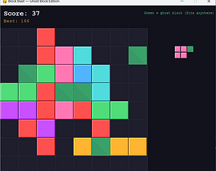

# Block Blast: Ghost Block Edition

A block-placing puzzle game in Python and Pygame. Drag pieces onto an 8×8 grid and fill rows or columns to clear them. The twist: every piece has at least one **ghost block** that can overlap cells that are already filled.

**[Visit the project page](https://cloudbv.github.io/ghost_block_blast/)** · **[Play / download on itch.io](https://cloudbv.itch.io/block-blast-ghost)**



## How it works

You get three pieces at a time. Place them on the grid, fill a full row or column to clear it and score, and the game ends when none of your pieces fit.

Ghost blocks (green, hatched) change the placement rules:

- Normal cells must land on **empty** cells.
- Ghost cells can land on **empty or filled** cells.
- Every cell of a piece must still be inside the board.
- A ghost on an empty cell fills it. A ghost on a filled cell leaves the existing block as it is.
- Ghost blocks count toward clearing lines like any other block.

## Features

- 25 piece shapes, from singles to pentominoes, each with a ghost cell
- Mouse-only controls with a placement preview
- Combo bonus for clearing several lines at once
- Local high score saved to a JSON file
- Flash effect on cleared lines

## Run it

Requires Python 3 and Pygame.

```bash
pip install pygame
python block_blast_ghost.py
```

(Replace `block_blast_ghost.py` with the game's filename in this repo.)

## Controls

| Input | Action |
| --- | --- |
| Left click a tray piece | Pick it up |
| Left click the grid | Place the held piece |
| Right click | Cancel and return the piece |
| Any key (start screen) | Start |
| `R` / `Q` or `Esc` (game over) | Restart / quit |

## Scoring

- 1 point per cell placed
- 10 points per cleared line
- +5 bonus per extra line cleared in the same move

## Files

| File | Purpose |
| --- | --- |
| `block_blast_ghost.py` | The whole game |
| `block_blast_highscore.json` | High score, created when you play |
| `index.html` | The project page |
| `screenshot.png` | Screenshot used in this README |
